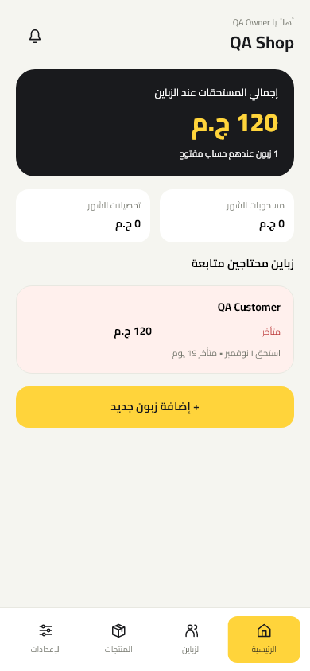
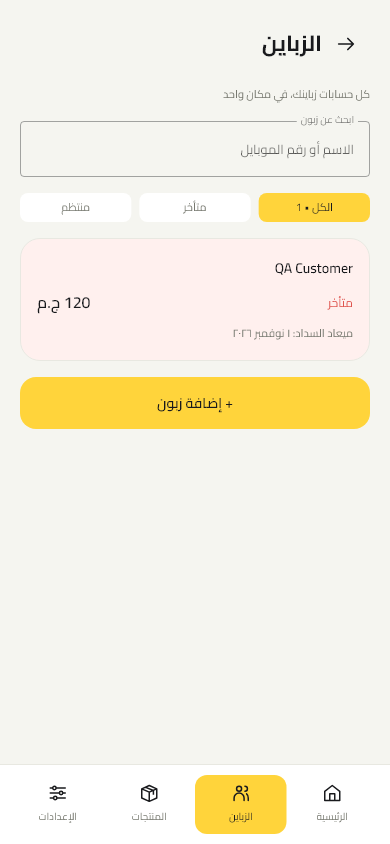
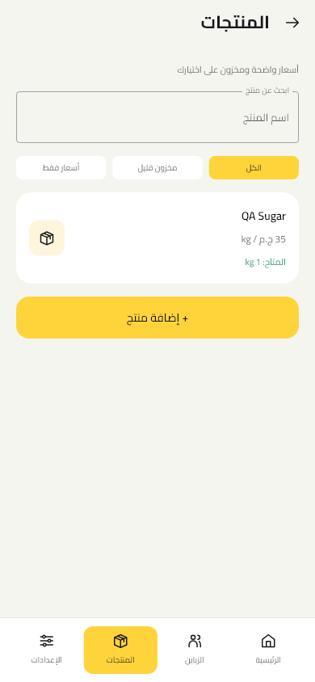

# MA7ALY | محلي

<p align="center">
  
</p>

**A Flutter & Firebase app for shop owners to manage customer credit accounts, payments, products, and inventory.**

MA7ALY helps small shops keep a clear customer ledger, follow up on repayments,
and track stock. It supports Arabic (RTL) and English with a responsive interface.

## Features

- **Dashboard:** outstanding balances, monthly payments and withdrawals, and customer follow-up.
- **Customer accounts:** customer records, opening balances, repayment schedules, and searchable lists.
- **Transactions:** withdrawals, payments, edits, deletion, and copyable payment receipts.
- **Inventory:** products, optional stock tracking, purchase/selling prices, and low-stock filters.
- **Consistent records:** atomic Firestore updates for balances and inventory, duplicate-request protection, and stale-edit checks.
- **Shop settings:** contact details, repayment reminders, language selection, and CSV account export to the clipboard.
- **Authentication:** email/password sign-in, registration, and password reset with Firebase Auth.

## Screenshots

Real Flutter screens rendered with the project's test fixtures; all names and amounts below are demo data.

| Dashboard | Customers |
| :---: | :---: |
|  |  |

| Products & inventory | Settings |
| :---: | :---: |
|  |  |

## Tech stack

| Area | Technology |
| --- | --- |
| App | Flutter / Dart |
| Architecture | Clean Architecture: data, domain, presentation |
| State & DI | Cubit, Freezed, GetIt |
| Backend | Firebase Authentication, Cloud Firestore |
| UI | Easy Localization, ScreenUtil, Flutter Animate, SVG |
| Data | Equatable, Multiple Result, JSON Serializable |

## Run locally

1. Install Flutter with Dart compatible with `pubspec.yaml` (Dart `^3.13.4`).
2. Run `flutter pub get`.
3. Configure your own Firebase project with FlutterFire CLI: `flutterfire configure`.
   This regenerates the excluded `lib/firebase_options.dart` and platform configuration.
4. Enable Email/Password Authentication and provision Firestore. Review and deploy
   the included Firestore rules and indexes to your own project.
5. Run `flutter run` on a configured device.

Firebase client configuration, environment files, signing material, and local build
outputs are excluded from Git. Configure Firebase before building a fresh checkout.
Profile photos are optional and require Cloud Storage; see the notes below.

## Validation

```sh
flutter analyze
flutter test
```

To regenerate the README screenshots with demo repositories:

```sh
flutter test test/readme_screenshots_test.dart --update-goldens
```

## Implementation notes

## Launcher icon

The mobile launcher icon uses an editable local SVG storefront in the app's
yellow/ink palette. Run `dart run flutter_launcher_icons` to regenerate Android
and iOS assets from the PNG sources in `assets/launcher/` using
`flutter_launcher_icons.yaml`. Android adaptive and monochrome assets are included.
See [the launcher icon report](docs/launcher_icon_implementation.md) for all files.

## Firebase

Project: `ma7aly-app-20261102` ([console](https://console.firebase.google.com/project/ma7aly-app-20261102/overview)).

Firebase Core is initialized in `lib/main.dart` using the generated
`lib/firebase_options.dart`. Configuration targets Android, iOS, web, and Windows.
Email/password Authentication is enabled. Account registration stores a private
profile at `users/{uid}` in the Standard Firestore database in `europe-west1`
(Belgium). Passwords and tokens are managed by Firebase Auth and are never stored
in profile documents. The mobile number is contact information, not SMS-verified.

The login screen includes password visibility, input validation, and password
reset. Registration collects name, mobile number, email, and password. Successful
authentication opens Home. Home follows Figma node `3:2536` and shows the saved
owner/shop names, outstanding customer debts, monthly payments and withdrawals,
and customers who need follow-up. Cards open customer accounts; adding a customer,
returning from an account, revisiting Home, or pulling to refresh reloads its data.
The bell scrolls to the follow-up section. `flutter_animate` handles staggered
card entrances, headings, buttons, and pulsing loading placeholders.

Profile photo selection/upload code is prepared but unavailable in the default
build until Cloud Storage is provisioned on the Blaze plan. Registering without
a photo works. After provisioning the bucket, deploy `storage.rules`, verify
owner access, and build with `--dart-define=PROFILE_PHOTOS_ENABLED=true`.
Storage upload and its rules have not been tested against a live bucket.

The original Authentication/profile rules were compiled and deployed. Live tests with two temporary users
verified registration, login, profile persistence, schema validation, and denial
of cross-user access; the test users and their profile documents were deleted.
These rules are a prototype to review before broad release.

## Customer accounts, inventory, and settings

Customer accounts now support withdrawals, payments, editing, deletion, and
copyable payment receipts. Selecting a tracked product adjusts its base-unit
stock in the same Firestore transaction as the movement and customer balance.
Changing products restores the old stock before deducting the new stock.
Retrying a successful request is idempotent; stale edits are rejected. Negative
stock and overpayments require confirmation. Excess payments become customer
credit. Amounts use integer piastres and quantities use integer thousandths;
quantity × unit price rounds half up to the nearest piastre.

Products support optional inventory tracking, purchase prices, low-stock alerts,
search, filters, and cursor pagination. The additional unit field is a description,
not a conversion factor. Movement quantities always use the base selling unit.
Shop settings include contact details, follow-up percentages/reminder days,
password reset, language switching, sign-out, and copying an account CSV report.
Receipts and reports are copied to the clipboard; native file sharing is not added.

The expanded `firestore.rules` has passed 43 local emulator checks. The actual
Flutter repositories were also exercised in headless Chrome against local Auth
and Firestore emulators, including concurrent writes. After user approval and
expanded page/navigation checks, the rules compiled without warnings and were
**deployed to `ma7aly-app-20261102`**. The 36 Flutter tests and `flutter analyze`
passed. A responsive loading-card overflow found during review was corrected.

I've set up prototype Security Rules to keep the data in Firestore safe. They are
designed to be secure for owner-only private records, strict schemas, immutable
timestamps, revision checks, and atomic balance/inventory updates. However, you
should review and verify them before broadly sharing your app. If you'd like,
I can help you harden these rules.

Account totals currently read the complete account ledger; movement display is
paged locally. Customer-list summaries also read those ledgers. Large histories
will need server aggregate queries/counters and cursor-based history loading.
Recurring schedules use the current month or week (clamped at month end and
bounded by the first due date). Overdue carried debt remains overdue before the
next cycle is due. Payments settle carried debt first; only the remainder counts
toward repayment of the new month's withdrawals.

See [the implementation report](docs/customer_inventory_implementation.md) for
the exact file list, validation, decisions, and deployment status.
See [the Home report](docs/home_implementation.md) for its file list and checks.

On Windows, enable **Settings > System > Advanced > For developers > Developer Mode**
if Flutter reports that plugins require symlink support, then run `flutter pub get`.
Building iOS requires macOS and Xcode.

Android debug APK build and launch were verified on an Android emulator.
Kotlin incremental compilation is disabled in `android/gradle.properties` to
avoid cross-drive cache errors when the project is on E: and the Pub cache is
on C:. This can increase Kotlin compilation time. iOS configuration targets
iOS 15 or later; an iOS build and launch must still be verified on macOS.

In VS Code, select a connected Android device or running emulator, then press
F5. For iOS, use VS Code on a Mac with Xcode configured and select an iPhone
or iOS simulator.

Follow the [official FlutterFire setup](https://firebase.google.com/docs/flutter/setup)
when adding Firebase services or configuring additional platforms.


